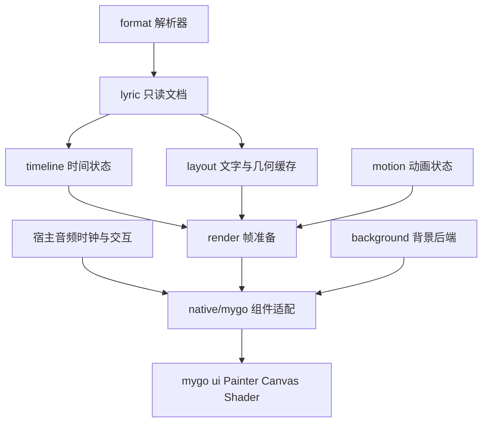

# 模块设计

状态：2026-11-09。纯 Go 核心、M2 格式与视觉时间、`examples/native` 的 M1 技术验证已有源码；M2 已由所有者确认验收通过，详见 [支持范围](m2-core-formats.md)。下文仍标“规划”的包是实施契约，不是已可调用 API。M1 示例内的非导出类型不构成公共组件。当前主模块为 `github.com/xiaowumin-mark/mygo-amll`，采用 Go 原生目录约定，不设置多余的 `src/` 层。

## 依赖方向

依赖只能向数据与算法层收敛。核心包不 import mygo；宿主不需要链接图形依赖即可使用解析和时间轴。先维持单 Go module、单版本发版；只有实际出现独立版本与工具链需求时才评估拆分 module。不要预先建立互相引用的空包。

| 包 | 职责与边界 | 状态 |
| --- | --- | --- |
| `lyric` | 验证并快照文档，逐词时间及文本元数据；无布局、播放器或 UI 状态 | 已实现 |
| `timeline` | 按宿主绝对时间查询活动/保留高亮/焦点/间奏/曲终；独立手动跟随控制，不持有时钟 | 已实现；M2 验收通过 |
| `format`、`format/lrc`、`format/yrc`、`format/qrc`、`format/ttml` | 公用限制/诊断与每种格式独立解析入口；不负责 I/O | 已实现明确子集；M2 验收通过 |
| `motion` | 弹簧/缓动、seek 和减少动态效果规则；显式输入时间 | 规划 |
| `layout` | 断行、shaping、cluster 与时间片段映射、可见范围 | 规划 |
| `render` | 准备只读帧数据、裁剪、高亮层、滚动和命中区域 | 规划 |
| `background` | 静态背景、封面颜色、低分辨率 shader 和转场 | 规划 |
| `native/mygo` | Native UI 容器、UI 线程资源、动画调度、输入与无障碍 | 规划 |
| `internal/...` | 可更换的缓存和几何实现；禁止宿主依赖 | 按需要添加 |
| `examples/...` | 小型可运行集成，合成或授权资产 | 时间索引、格式/视觉状态及 M1 Native 技术验证示例；平台验收见 [记录](m1-native.md) |

## 文档与时间语义

当前 `lyric.NewDocument([]lyric.Line)` 验证后复制行、词及词内 Ruby 切片。`NewDocumentWithMetadata` 还快照有序 `Property`，重复键不丢失。字符串作为 Go 不可变值共享；格式层通过克隆输出字符串避免小子串保留巨大输入。通过 `Document.Line(i)` 的只读 `LineView` 访问数据；`Word(i)` 深复制可选 Ruby 切片，普通无 Ruby 词无需分配，`RubyCount` / `Ruby` 提供无需复制切片的逐项读取。`Property(i)` 返回值副本。显式行 ID 必须唯一，省略则生成确定性的文档局部 ID；Agent/Language 保留源语义。背景行的可选 `ParentID` 必须指向文档内的非背景主行，稳定时间排序不改变关联。索引越界沿用 Go 切片的 panic 语义；`LineView` 零值不可使用。视图会保留所属文档的底层存储，换曲时必须清理缓存引用。

时间统一为 `time.Duration` 的歌曲绝对位置，词不是行内相对偏移。默认 `NewDocument` / `NewDocumentWithMetadata` 继续要求行、词区间 `0 <= start < end`，行和词按开始时间非递减排列，词必须落在所属行区间；允许相同开始、交叠、对唱和背景唱词。Ruby 在默认构造下按开始时间排列、位于所属词内，允许点注释。空文档合法，非法输入返回包含行/词索引的错误；核心不隐式排序、猜测结束时间或截断输入。

`NewDocumentWithOptions(lines, metadata, DocumentOptions{PreserveSourceTiming: true})` 是显式的源时间保留入口。它要求行按开始时间排列，行、词和 Ruby 的两个端点均非负；原样保留文本顺序、点区间、反向行/词时间、非单调词开始及越出父区间的端点，不交换、裁剪或重排。各格式在解析层显式选择兼容规则，不通过放宽默认构造器接收历史源数据。点行与反向行可以保存和查询，但不会成为活动的半开区间；点词及反向词的呈现由宿主决定。默认严格构造器的拒绝行为不变。设计与调用示例见 [RFC 0005](rfcs/0005-m2-corpus-compatibility.md)。

当前模型还保留逐词 `Obscene`、`EmptyBeat` 与 timed Ruby。TTML 按固定 AMLL 的简化歌词视图选择首个可用翻译/音译，内联值优先于 sidecar，逐词 sidecar 音译按开始时间和区间交并比匹配；不暴露全部语言和逐词翻译数组。`ttm:agent` 的类型声明用于源顺序对唱交替：group 不改变交替状态，首次 other 从对唱侧开始，其他不同非 group ID 切换侧；背景继承主行侧。根语言、timingMode、songwriters 和无资源 audio 的 lyricOffset/role 作为属性保留，audio 属性不触发播放、偏移或 I/O。严格 XML 命名空间检查拒绝未声明前缀和重复展开属性。该模型不承诺完整 TTML、Apple 扩展或无损往返。

当前 `timeline.New(doc)` 用每行一个 `time.Duration` 保存前缀最大结束时间，引用只读文档，不再复制全文。`ActiveAt(position, dst)` 清空并复用调用方切片，按文档顺序返回所有活动行；不足的容量会触发扩容。查询可任意前后 seek。复杂度是 `O(log n + c)`，`c` 为候选窗口，长区间重叠时最坏 `O(n)`，不是无条件 `O(log n + 活动行数)`。

M2 的 `VisualAt` 已区分活动唱词、持续高亮、当前滚动锚点、间奏区间和结束态，使用既有索引且可由绝对时间重建 seek 状态，不额外增加每行存储。源时间保留文档的最近开始组若只有点行且没有活动高亮，焦点取该开始时间的首行，高亮保持空；查询不因空高亮组越界。活动和高亮使用调用方提供的两个不重叠缓冲，复杂度同样为 `O(log n + c)`。`FollowController` 只控制是否应用自动焦点，由宿主注入单调交互时间和可见性，不持有文档、时钟或 UI 资源；其可变实例不支持并发调用。行唱完后仍可能保留高亮，不能将 `ActiveAt` 的结果直接当成最终视觉状态。完整规则见 [M2 说明](m2-core-formats.md)。

## 播放时钟与动画

宿主拥有音频播放与同步。计划由组件接受时间锚点：歌曲位置、对应单调时钟、播放速率和暂停状态。绘制时从锚点推导歌曲位置；seek、变速、恢复或换曲更新锚点并使相关状态失效。不得每帧累加音频位置，也不得用弹簧动画 delta 作为歌曲时间。

动画层使用单调时钟，暂停音频不等于所有 UI 动画立刻冻结；减少动态效果与应用显式禁用动画分别定义。隐藏恢复、很长帧间隔与 seek 应采用可重建/收敛策略，避免模拟海量历史帧。`Draw` 可以被重复调用，时间状态转换和用户事件不得隐含依赖调用次数。

## 文本与高亮

以整行 shaping 为单位，保留字形、断行、基线与视觉顺序。时间词段应映射到明确的文本范围，再映射 cluster 和视觉片段，避免分别 shape 单个词破坏连字、字距及双向文本。

mygo `Glyph.Cluster/Runes` 使用 rune 索引，`TextLayout` 几何 API 使用 UTF-16 索引；Go 字符串切片则是字节索引。后续实现必须用不同类型表示三种范围，并集中转换。复杂 emoji、组合附加符、RTL 和 ruby 不可凭字节长度推导宽度。高亮区域可能由多个矩形组成。

缓存键至少包含文档代次、行号、布局宽度桶、字体及 fallback、字号、DPI、语言/方向和影响几何的样式版本。播放时间变化只更新高亮与动画参数，不重新 shape 全曲。失效表：

| 事件 | 必须失效 | 可保留 |
| --- | --- | --- |
| 换曲 | 文档相关时间状态、布局、帧和交互引用 | 与歌曲无关的着色器程序 |
| seek/速率变化 | 时间游标、滚动目标与高亮状态 | 不变的文字布局 |
| 尺寸/DPI/字体变化 | 相关几何和纹理缓存 | 文档与时间索引 |
| 纯颜色变化 | 颜色参数及必要的绘制层 | 几何缓存 |
| 内存压力 | 预取和不可见行缓存、非必要背景层 | 保证当前可见内容所需资源 |

## 线程、资源与宿主边界

后台只处理解析、不可变数据准备和明确支持并发的布局操作。UI 线程拥有可变 Painter、Canvas、Bitmap、shader 参数与组件状态；后台结果经 `Window.Update` 提交并校验歌曲代次，过期任务需取消或丢弃。`ui.Element` 仅当前构建有效，不跨帧保存；持久身份用上游公开 Handle。

组件计划提供显式停用/销毁入口，负责取消任务、停止调度、移除回调与解除资源引用。此入口不能承诺同步释放 GPU 内存：当前上游 Canvas 没有公开 Close/Resize，必须尊重上游回收边界。所有缓存与离屏层都要有数量和字节预算。

宿主负责音频、文件/网络访问、窗口生命周期、主题与字体选择。库负责呈现和交互请求；点击歌词只返回目标位置与行身份，由宿主决定 seek。不得绑定播放器、网络服务、全局 goroutine 或隐式单例缓存。Native 自绘必须补充键盘滚动、焦点、减少动态效果和可供辅助技术读取的歌词语义；逐词动画不等于每帧广播无障碍状态。
