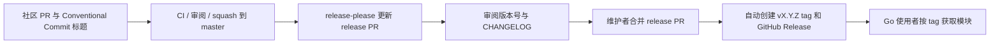

# 版本与自动发版

仓库默认分支为 `master`。Go module 为 `github.com/xiaowumin-mark/mygo-amll`。当前尚未发布版本；初始 manifest 为 `{}`，`initial-version` 指定首次版本 `0.1.0`。不要手动创建一个没有对应实现和变更记录的“初始版本”。

## 维护者首次启用

提交并推送本次初始化后，在 GitHub 完成以下设置。这些是托管侧设置，仓库内的 YAML 无法替维护者启用；本次初始化未修改远程设置。

1. 在 **Settings → Actions → General** 允许本仓库使用 Actions；若使用下文受限的 `GITHUB_TOKEN` 后备方式，还需勾选 **Allow GitHub Actions to create and approve pull requests**。workflow 内已将写权限限制到发布 job。
2. 启用 **Squash merging**，将 squash 默认提交消息配置为 **Pull request title**。使用 squash 合并社区 PR，保证 Conventional Commit 标题进入默认分支历史；维护者合并前核对最终标题和破坏性变更。
3. 建立 `master` ruleset/分支保护，禁止直接推送及强制推送，要求 PR、至少一位其他维护者审阅，并把 **CI** 的所有 Core jobs、benchmark job 和 **PR title / Conventional Commits** 设为必需检查。先让工作流执行一次，再从 GitHub 提供的实际检查名称选择；不要猜测名称。维护者人数不足时公开记录临时审阅安排。
4. 保持 Issues 开启；建议在 **Settings → General → Features** 启用 **Discussions**，用于公开 RFC、设计讨论和答疑。新建里程碑和标签时以实际工作为准，不依赖未创建的 label。
5. 在 **Settings → Advanced Security → Private vulnerability reporting** 启用私密漏洞报告，核对仓库 **Security → Advisories → Report a vulnerability** 入口可用，与 `SECURITY.md` 的报告路径保持一致。GitHub 不同版本的菜单名称可能显示为 **Code security**。
6. 按下一节配置专用 GitHub App，再检查 Release workflow 能建立 release PR，且该 PR 的 CI 和标题检查由 `pull_request` 事件运行。权限或分支保护不允许时先修复托管配置，避免绕过审阅直接打 tag。

## GitHub App 与后备方式

推荐使用专用 GitHub App，让机器人建立/更新 release PR 后正常触发 `pull_request` 工作流，满足必需检查的事件要求。无需 PAT；维护者仍负责审阅并合并 release PR。

1. 在仓库所属用户或组织的 **Settings → Developer settings → GitHub Apps → New GitHub App** 创建专用 App，主页可填写仓库 URL。此 App 只用于 Actions 内调用 API，不需要 webhook 服务，可关闭 webhook 的 **Active**。
2. Repository permissions 仅授予 **Contents: Read and write**、**Pull requests: Read and write**，保留默认的 **Metadata: Read-only**。不申请 Actions 写权限、组织权限或额外订阅事件。
3. 安装 App 时选择 **Only select repositories**，仅授权本仓库。保存数值 **App ID**，它与 Client ID 不同。
4. 在 App 设置中生成 private key，将 PEM 内容保存在本仓库 **Settings → Secrets and variables → Actions → Secrets** 的 `RELEASE_APP_PRIVATE_KEY`；在 **Variables** 新建 `RELEASE_APP_ID`，值为数值 App ID。不要提交 PEM、打印 key 或在 PR 中展示 key。
5. 发布工作流按需生成短期 installation token，再次限制到当前仓库的 Contents/PR 写权限；job 完成后由 token action 自动撤销。只有 `master` 上的 release job 读取私钥；社区 PR 的 CI 不使用 App 或其私钥。
6. 首次启用后检查 release PR 对应工作流的 event 为 `pull_request`，head SHA 与 PR 最新提交相符，且 required checks 在 PR 中实际出现并通过。更新 release PR 后要重新核对最新提交，旧提交的成功结果不能代替。

未配置 `RELEASE_APP_ID` 时，发布工作流退回内置 `GITHUB_TOKEN`。该方式可创建 release PR/tag/release，但机器人 PR 的检查可能被抑制，或处于需要维护者 **Approve workflows to run** 的状态；不能承诺无人干预或满足 required checks。遇到没有合格 PR 检查的情况应完成 App 配置，再由 App 更新 release PR，保留正常审阅流程。配置了 App ID 却缺少 private key 时，工作流会明确失败；不会静默退回后备 token。

`workflow_dispatch` 仅供手动诊断，不能补足 required PR checks：GitHub 说明这类工作流 job 即使运行在 PR head SHA，也不会作为 PR 的必需检查被评估。本仓库因此没有使用 dispatch 冒充 PR 检查，也没有申请 `actions: write`。相关官方规则见文末固定版本来源。

## 版本流程



`feat`、`fix`、`perf` 等变更按 release-please 的 Go 策略生成版本；只有文档/CI/维护类提交时，通常不会单独发版。`feat` 增加 minor，`fix`/`perf` 增加 patch；`0.x` 阶段的 `!` 或 `BREAKING CHANGE:` 增加 minor。首次版本固定从 `0.1.0` 开始；进入 `1.0.0` 前应明确公共 API、兼容平台及渲染验收结论，并审阅版本策略。版本号判断以生成的 release PR 为准，合并前必须核对。

release PR 包含自动更新的 `CHANGELOG.md` 和 `.release-please-manifest.json`。维护者必须确认目标 commit、最低 Go 版本、破坏性变更、许可证与验证结果。合并 release PR 后，同一 `Release` 工作流创建 tag 和 GitHub Release。发布 job 仅在 `refs/heads/master` 运行；手动调度其它分支不会执行发布。Go 库直接通过 Git tag 分发，无需打包平台可执行文件，也不需要 npm 或 Go proxy 发布密钥。

例如，在实际 `v0.1.0` tag 发布后，使用者可执行：

```sh
go get github.com/xiaowumin-mark/mygo-amll@v0.1.0
```

tag 和 GitHub Release 均由现有 `Release` 工作流直接创建，没有依赖后续 tag push/release 事件的第二条发布流水线。将来需要上传额外产物时，可在同一 workflow 使用 `steps.release.outputs.release_created` 直接衔接。此输出只在实际创建 release 时产生；不能用它判断 release PR 是否建立。

## 检查与依赖更新

`CI` 对 Windows、Linux、macOS 的 Go `1.27.3` 及 Linux 最新 stable 执行 `python scripts/check.py`：gofmt、vet、普通测试与 race detector、PR 标题检查器测试、diff whitespace。race detector 需要 `CGO_ENABLED=1` 和 C 编译器；这是测试工具要求，不能据此认为 Native UI 本身依赖 CGO。本地确实没有 C 工具链时，可运行 `python scripts/check.py --no-race`，并在 PR 说明，CI 的 race 检查仍必须通过。

benchmark job 上传 `ns/op`、`B/op`、`allocs/op` 及环境信息，保留 14 天。共享 runner 上的时间波动不作为渲染帧率结论；真实 GPU/帧时/RSS 验收按性能文档执行。新增依赖前审查其构建、许可证和资源成本。

Dependabot 每周更新 Go modules 与固定 SHA 的 Actions，维护者审阅并经相同 CI 合并。依赖为空时不创建虚假的 `go.sum`。fork PR 的工作流仅有只读权限，不使用 secrets，也不使用 `pull_request_target` 执行 PR 代码。

## 失败与恢复

- CI 失败：修复源代码或配置并重新运行，不能通过删除检查完成发布。
- release PR 不出现：核对 Actions 权限、默认分支、可发布提交类型、workflow 日志与 manifest；维护类提交不保证触发版本。
- tag/release 已存在：不要删除、移动或重新使用已发布 tag。修复后通过新的补丁版本发布。
- 模块不可获取：确认 tag 位于正确仓库、go.mod module 路径正确、版本符合 Go 规则；Go proxy 收录可能延迟，避免伪称已发布成功。
- 严重版本问题：记录影响，在可用时通过 `go.mod` 的 `retract` 撤回受影响版本并发布修复；保留历史记录。

本地验证不会调用 GitHub 发版，也不会推送或修改远程设置。所有文件落地后仍需真实 GitHub runner 首次执行确认托管环境与权限。

## 实现核对与官方来源

- 当前固定的 [release-please-action 源码](https://github.com/googleapis/release-please-action/blob/8b8fd2cc23b2e18957157a9d923d75aa0c6f6ad5/src/index.ts#L219) 确实输出 `prs_created`、`pr`、`prs`；其 [lockfile](https://github.com/googleapis/release-please-action/blob/8b8fd2cc23b2e18957157a9d923d75aa0c6f6ad5/package-lock.json) 锁定 release-please `17.3.0`，该版本的 [PullRequest 接口](https://github.com/googleapis/release-please/blob/891bcf6253b390e39df9ff3e1c059a836bd39c98/src/pull-request.ts#L15) 包含 `headBranchName` 和 `title`。当前流程无需消费这些 PR 输出。
- release-please `17.3.0` 的 [manifest 解析](https://github.com/googleapis/release-please/blob/891bcf6253b390e39df9ff3e1c059a836bd39c98/src/manifest.ts#L1526) 接受 `{}`；[配置转换](https://github.com/googleapis/release-please/blob/891bcf6253b390e39df9ff3e1c059a836bd39c98/src/manifest.ts#L1423) 与 [初始版本处理](https://github.com/googleapis/release-please/blob/891bcf6253b390e39df9ff3e1c059a836bd39c98/src/strategies/base.ts#L739) 支持 `initial-version`，无先前 release 时采用配置的 `0.1.0`。
- GitHub 官方文档固定版本：[GITHUB_TOKEN 的工作流触发限制与机器人 PR 批准](https://github.com/github/docs/blob/8cd1075179df75319912891d6620c9cb78eefb4d/data/reusables/actions/actions-do-not-trigger-workflows.md)、[PR 必需检查的 commit 与事件要求](https://github.com/github/docs/blob/8cd1075179df75319912891d6620c9cb78eefb4d/content/pull-requests/how-tos/merge-and-close-pull-requests/troubleshooting-required-status-checks.md#L35)。这些是设计依据，不代表本仓库已在 GitHub 完成端到端验证。
